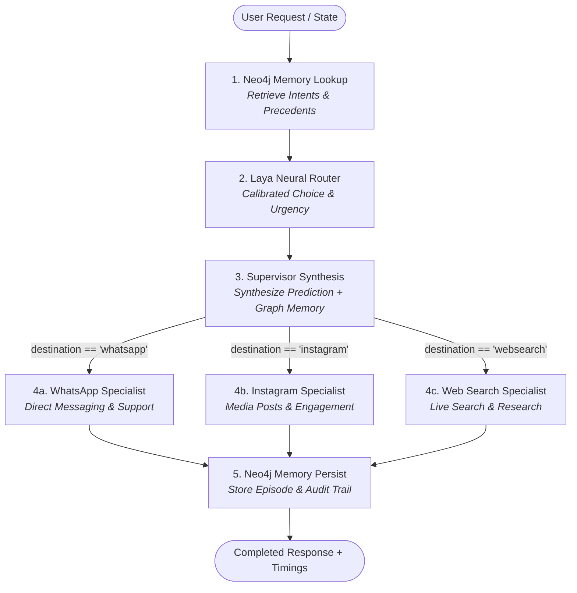
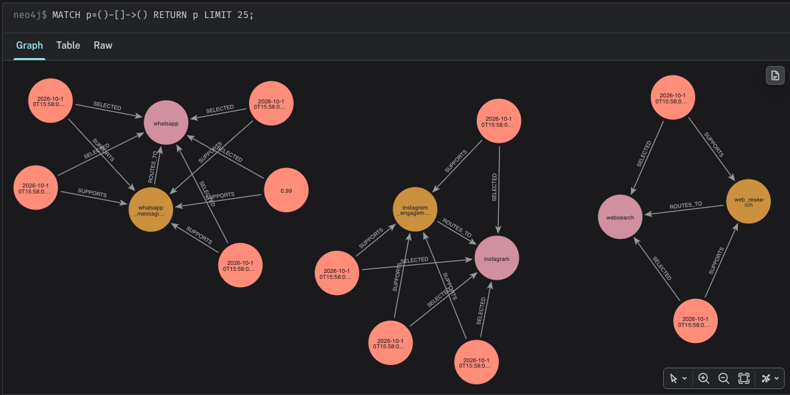

# ⚡ Laya + LangGraph Agent Router with Neo4j Episodic Memory

A high-performance LangGraph project implementing intelligent, non-autoregressive agent routing with institutional knowledge graph memory (Neo4j) and sub-millisecond phase timing.

This project expands single-prompt routing into a full multi-agent state graph pipeline where routing decisions are informed, verified, and audited by a Neo4j knowledge graph.

---

## 🏛️ Architecture Overview



---

## ⏱️ Real-Time Operation Timing

Every phase of the pipeline is tracked using high-resolution monotonic clocks (`time.perf_counter()`), providing breakdown metrics in milliseconds:

| Phase | Metric Key | Description | Typical Latency |
|---|---|---|---|
| **1. Memory Lookup** | `memory_lookup_ms` | Cypher search across intents & past episodes in Neo4j | ~10 - 25 ms |
| **2. Laya Router** | `laya_router_ms` | Non-autoregressive neural classification on Apple Silicon MPS | ~50 - 90 ms (warmed) |
| **3. Supervisor** | `supervisor_decision_ms` | Bayesian synthesis of Laya probabilities + Neo4j memory consensus | < 0.1 ms |
| **4. Specialist** | `specialist_execution_ms` | Targeted specialist execution (WhatsApp / Instagram / Web Search) | < 0.1 ms |
| **5. Neo4j Persist** | `memory_persist_ms` | Writes `RoutingEpisode` node, relationships, and outcome | ~20 - 40 ms |
| **Total Pipeline** | `total_ms` | Complete end-to-end execution of the LangGraph state machine | **~90 - 150 ms** |

---

## 🧠 Neo4j Institutional Memory Schema

Neo4j is modeled to track routing precedent and improve accuracy:

```cypher
(:Intent {name: string})
(:Specialist {name: string, description: string})
(:Intent)-[:ROUTES_TO {source: string, updated_at: datetime}]->(:Specialist)

(:RoutingEpisode {
    id: uuid,
    query: string,
    intent: string,
    selected: string,
    urgency: string,
    confidence: float,
    execution_time_ms: float,
    success: boolean,
    reasoning: string,
    created_at: datetime
})
(:RoutingEpisode)-[:SUPPORTS]->(:Intent)
(:RoutingEpisode)-[:SELECTED]->(:Specialist)
```

### Memory Decision Synthesis
- **Consensus Boosting**: If Laya predicts `whatsapp` and Neo4j has matching historical episodes for `whatsapp_messaging -> whatsapp`, confidence is boosted and historical precedents are cited in the rationale.
- **Memory Override / Fallback**: If Laya is uncertain (confidence < 45%) but Neo4j contains strong historical precedent, the institutional memory guides the decision.
- **Novel Route Registration**: Novel requests are routed zero-shot by Laya and subsequently saved to Neo4j to continually expand institutional knowledge.
- **Continuous Feedback**: User feedback (thumbs up / thumbs down) updates `success` on the episode in Neo4j.

---

## 📁 Project Structure

```
Agent/
├── app/
│   ├── docs/
│   │   └── Graph_browser.neo4j.io.png # Neo4j browser visual snapshot
│   ├── __init__.py           # Package marker
│   ├── routing_memory.py     # Neo4j GraphDatabase driver & episodic memory API
│   ├── supervisor.py         # Laya Router singleton, warm-up & decision synthesis
│   ├── graph.py              # LangGraph StateGraph pipeline with timed nodes
│   ├── main.py               # CLI runner with rich timing & decision output
│   └── streamlit_app.py      # Streamlit interactive UI with cards & live Neo4j explorer
├── docker-compose.yaml       # Neo4j 2025.10 container configuration
├── requirements.txt          # Frozen dependencies
└── README.md                 # Project documentation
```

---

## 🚀 Getting Started

### 1. Ensure Neo4j is Running
Neo4j is configured in `docker-compose.yaml`:
```bash
docker compose up -d
```
Access local Neo4j Browser at: `http://localhost:7474` (credentials: `neo4j` / `localdevpassword`).

### 2. Run the CLI Application
```bash
.venv/bin/python app/main.py
```

### 3. Run the Streamlit Web Application
```bash
.venv/bin/streamlit run app/streamlit_app.py
```
Open [http://localhost:8501](http://localhost:8501) in your browser.

---

## 🌐 Visualizing the Knowledge Graph in Neo4j Browser

You can explore and interact with the institutional routing memory using the official cloud-hosted [Neo4j Browser](https://browser.neo4j.io/) or the local instance at [http://localhost:7474](http://localhost:7474).

### Step-by-Step Guide to Connect via https://browser.neo4j.io/

1. **Start the Neo4j Container**:
   Ensure Neo4j is running via Docker Compose:
   ```bash
   docker compose up -d
   ```
2. **Open Neo4j Browser**:
   Navigate to [https://browser.neo4j.io/](https://browser.neo4j.io/) in your web browser.
3. **Configure Connection Parameters**:
   In the connection dialog:
   - **Connection URL**: `bolt://localhost:7687` (or `neo4j://localhost:7687`)
   - **Authentication Type**: `Username / Password`
   - **Username**: `neo4j`
   - **Password**: `localdevpassword`
   - **Database**: `neo4j`
4. **Connect & Query**:
   Click **Connect**. Once authenticated, run the following Cypher query in the query input at the top:
   ```cypher
   MATCH p=()-[]->() RETURN p LIMIT 25;
   ```

### Graph Visualization Preview

The snapshot below shows the clusters created with the existing example intents, specialist agents, and episodic routing decisions:



*The graph illustrates the three core routing clusters (`whatsapp`, `instagram`, and `websearch`), their assigned intent definitions connected via `[:ROUTES_TO]`, and individual `RoutingEpisode` nodes connected via `[:SELECTED]` and `[:SUPPORTS]`.*

### Handy Cypher Queries for Graph Exploration

- **Inspect All Routing Precedents (Intents → Specialists)**:
  ```cypher
  MATCH (i:Intent)-[r:ROUTES_TO]->(s:Specialist)
  RETURN i, r, s;
  ```

- **View Recent Routing Episodes with Context and Outcomes**:
  ```cypher
  MATCH (e:RoutingEpisode)-[r:SELECTED|SUPPORTS]->(target)
  RETURN e, r, target
  ORDER BY e.created_at DESC
  LIMIT 25;
  ```

- **Inspect Routing Statistics by Specialist**:
  ```cypher
  MATCH (e:RoutingEpisode)
  RETURN e.selected AS specialist,
         count(e) AS total_episodes,
         avg(e.execution_time_ms) AS avg_duration_ms,
         sum(CASE WHEN e.success THEN 1 ELSE 0 END) AS successful_count;
  ```

